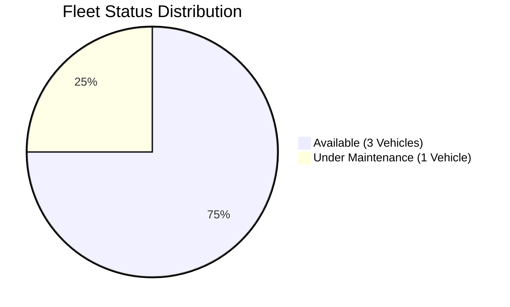
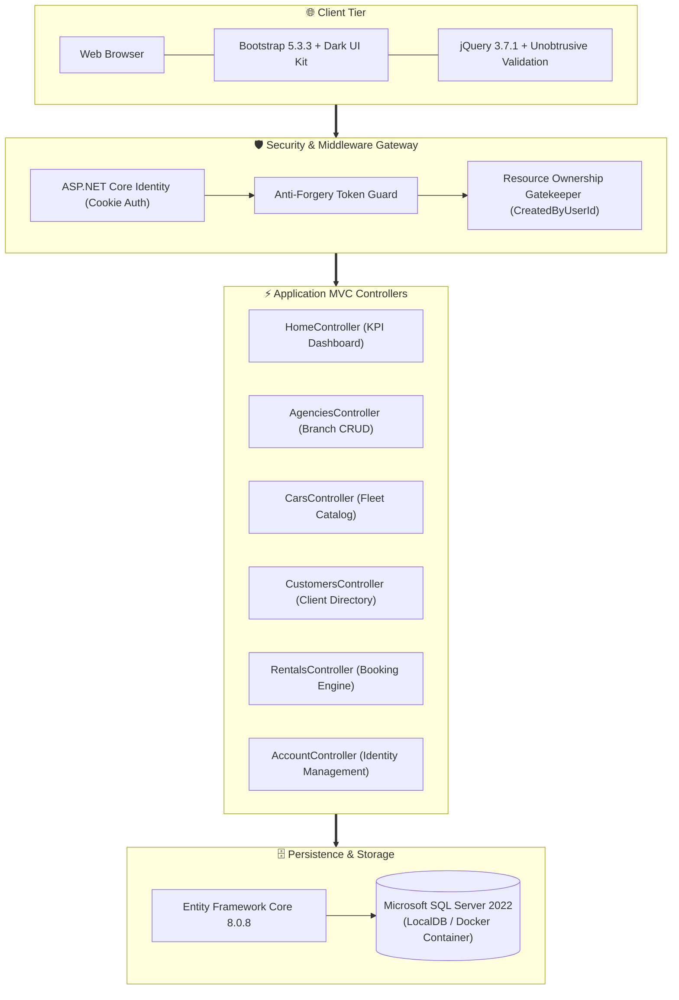
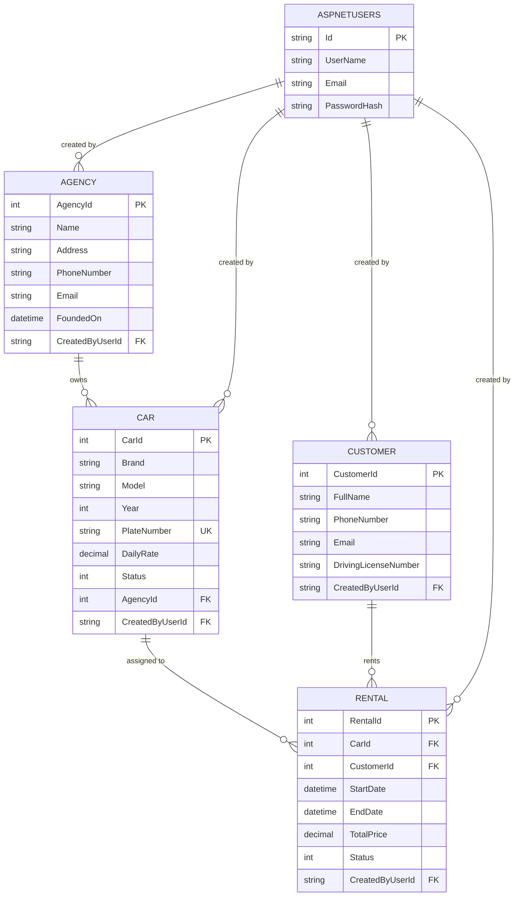
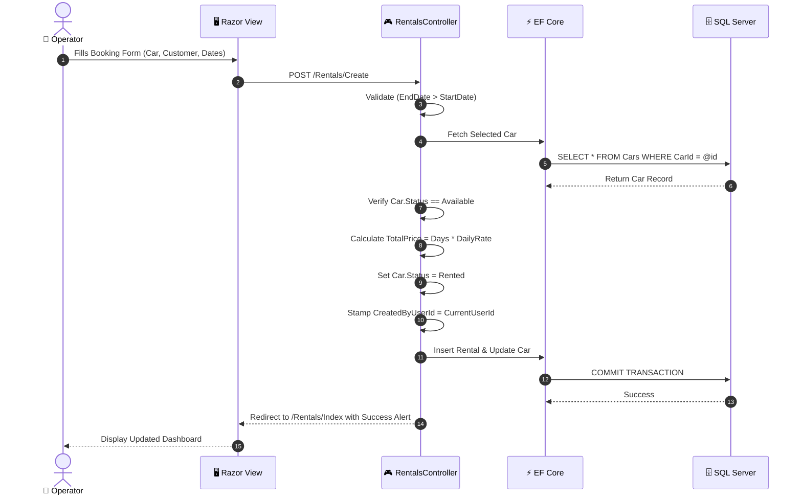
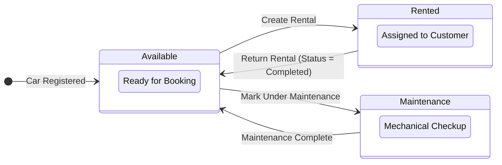

# 🚘 Car-Agencies-Rental

<div align="center">

### **Enterprise-Grade Car Rental Fleet Management & Leasing Lifecycle Platform**

*Built with ASP.NET Core 8 MVC, Entity Framework Core 8, Microsoft SQL Server 2022, and Docker.*

<br/>

[](https://dotnet.microsoft.com/)
[](https://learn.microsoft.com/dotnet/csharp/)
[](https://dotnet.microsoft.com/apps/aspnet/mvc)
[](https://www.nuget.org/packages/Microsoft.EntityFrameworkCore)
[](https://www.microsoft.com/sql-server)
[](https://getbootstrap.com/)
[](https://www.docker.com/)
[](LICENSE)

<br/>

**[⚡ Features](#-features) • [📊 Analytics & Metrics](#-analytics--metrics) • [🏗️ Architecture](#-system-architecture) • [🗄️ Database ERD](#-database-schema--erd) • [🔄 Workflows](#-operational-workflows) • [🚀 Quick Start](#-quick-start)**

---

</div>

<br/>

## ⚡ Features

### 🏢 Multi-Branch Agency Management
- Manage multiple independent car rental branches across different geographic locations.
- Complete branch directory with contact details, foundation dates, and cascading fleet management.

### 🚗 Dynamic Fleet Inventory & Availability Tracking
- Real-time vehicle availability management (`Available`, `Rented`, `UnderMaintenance`).
- Comprehensive vehicle catalog including brand, model, manufacturing year, license plate, and daily rates.
- Multi-parameter filtering by operating agency and vehicle status.

### 💰 Automated Rental Pricing Engine
- Server-side automatic price calculation based on rental duration and vehicle daily rates:
  $$\text{Total Price} = \max(1, \text{Days}) \times \text{Daily Rate}$$
- Prevents client-side price tampering and eliminates manual calculation errors.
- Automatic atomic status transition: vehicle flips to `Rented` on booking, and back to `Available` on return.

### 👥 Customer & Driver Directory
- Dedicated customer registry recording full name, phone number, email, and driving license number.
- Relational audit history showing all historical and current bookings per customer.

### 🛡️ Enterprise Security & Resource-Level Ownership
- Full user authentication powered by **ASP.NET Core Identity** with cookie sessions.
- **Resource Ownership Guards:** Users can view shared agency data, but edit and delete operations are restricted strictly to the user who created the record (`CreatedByUserId`).
- Cryptographic CSRF protection via `[ValidateAntiForgeryToken]` on all state-altering requests.
- Concurrency conflict handling (`DbUpdateConcurrencyException`).

### 📊 Executive KPI Dashboard
- Centralized real-time overview displaying total branches, active leases, available vehicles, and cumulative rental revenue.
- Quick-action shortcuts and an audit table of recent rental transactions.

### 🎨 Modern Dark-Themed UI Kit
- Built with a custom 788-line CSS design system (`site.css`) on top of Bootstrap 5.3.3.
- Features deep navy themes, glassmorphism cards, responsive tables, badge pills, and unobtrusive client-side validation.

---

## 📊 Analytics & Metrics

### 📈 Platform Technical Breakdown

| Metric Dimension | Real Value | Description |
| :--- | :---: | :--- |
| **Framework Target** | `.NET 8.0` | C# 12 running on ASP.NET Core 8 MVC |
| **HTTP Action Endpoints** | **40 Endpoints** | Distributed across 6 MVC controllers |
| **Database Tables** | **11 Tables** | 4 Domain tables + 7 ASP.NET Identity tables |
| **Razor Views** | **21 Views** | Strongly-typed `.cshtml` templates with 6 ViewModels |
| **Custom Styling** | **788 Lines** | Custom dark design system in `site.css` |
| **Docker Containers** | **2 Services** | Web Application (`:8080`) + SQL Server 2022 (`:1433`) |
| **Seed Fleet Assets** | **4 Cars** | 2 Agencies, 2 Customers, 2 Initial Rentals |

<br/>

### 📊 Fleet Availability Breakdown



<br/>

### 📊 Seed Vehicle Daily Rates Comparison (EGP)

```
Chevrolet Optra    [25.00 EGP]  █████████████░░░░░░░░░░░░░░░
Hyundai Elantra    [30.00 EGP]  ████████████████░░░░░░░░░░░░
Toyota Corolla     [35.00 EGP]  ███████████████████░░░░░░░░░
Kia Sportage       [45.00 EGP]  ████████████████████████░░░░
```

---

## 🏗️ System Architecture

### 1. End-to-End System Blueprint



---

## 🗄️ Database Schema & ERD



### Relational Integrity Rules:
- **Agency ➔ Cars:** `Cascade Delete` — Deleting an agency cascades to remove all associated cars.
- **Car ➔ Rentals:** `Restrict Delete` — Vehicles with active or historical rental contracts cannot be deleted.
- **Customer ➔ Rentals:** `Restrict Delete` — Customer records with associated contracts cannot be deleted.
- **Plate Number:** Unique index constraint on `Cars.PlateNumber`.

---

## 🔄 Operational Workflows

### 1. Rental Booking Transaction Sequence



---

### 2. Vehicle & Rental Lifecycle State Machine



---

## 🌐 API & Controller Routes

### 🔐 Account Management (`/Account`)
| Method | Route | Description | Access |
| :---: | :--- | :--- | :---: |
| `GET` | `/Account/Register` | Operator registration page | Public |
| `POST` | `/Account/Register` | Process registration and sign in | Public |
| `GET` | `/Account/Login` | Operator sign-in page | Public |
| `POST` | `/Account/Login` | Validate credentials and issue cookie | Public |
| `POST` | `/Account/Logout` | Terminate session and clear cookie | Authenticated |

### 📊 Dashboard (`/Home`)
| Method | Route | Description | Access |
| :---: | :--- | :--- | :---: |
| `GET` | `/` or `/Home/Index` | Executive KPI analytics & recent activity | Authenticated |
| `GET` | `/Home/Error` | Error diagnostics page | Public |

### 🏢 Agency Branches (`/Agencies`)
| Method | Route | Description | Access |
| :---: | :--- | :--- | :---: |
| `GET` | `/Agencies` | Branch directory with name search | Authenticated |
| `GET` | `/Agencies/Details/{id}` | Detailed branch overview and fleet table | Authenticated |
| `GET` | `/Agencies/Create` | Branch creation form | Authenticated |
| `POST` | `/Agencies/Create` | Store new branch with ownership tag | Authenticated |
| `GET` | `/Agencies/Edit/{id}` | Edit branch details | Owner Only |
| `POST` | `/Agencies/Edit/{id}` | Update branch details | Owner Only |
| `GET` | `/Agencies/Delete/{id}` | Deletion confirmation page | Owner Only |
| `POST` | `/Agencies/Delete/{id}` | Delete branch and cascade to fleet | Owner Only |

### 🚗 Fleet Inventory (`/Cars`)
| Method | Route | Description | Access |
| :---: | :--- | :--- | :---: |
| `GET` | `/Cars` | Fleet list with agency and status filters | Authenticated |
| `GET` | `/Cars/Details/{id}` | Specs and complete rental history | Authenticated |
| `GET` | `/Cars/Create` | Vehicle registration form | Authenticated |
| `POST` | `/Cars/Create` | Register new vehicle | Authenticated |
| `GET` | `/Cars/Edit/{id}` | Edit vehicle specs | Owner Only |
| `POST` | `/Cars/Edit/{id}` | Update vehicle specs | Owner Only |
| `GET` | `/Cars/Delete/{id}` | Vehicle deletion confirmation | Owner Only |
| `POST` | `/Cars/Delete/{id}` | Remove vehicle (Restricted if rented) | Owner Only |

### 👥 Customer Directory (`/Customers`)
| Method | Route | Description | Access |
| :---: | :--- | :--- | :---: |
| `GET` | `/Customers` | Customer directory with search | Authenticated |
| `GET` | `/Customers/Details/{id}` | Customer profile and past contracts | Authenticated |
| `GET` | `/Customers/Create` | Customer registration form | Authenticated |
| `POST` | `/Customers/Create` | Register customer with license info | Authenticated |
| `GET` | `/Customers/Edit/{id}` | Edit customer details | Owner Only |
| `POST` | `/Customers/Edit/{id}` | Update customer details | Owner Only |
| `GET` | `/Customers/Delete/{id}` | Customer deletion confirmation | Owner Only |
| `POST` | `/Customers/Delete/{id}` | Remove customer (Restricted if rented) | Owner Only |

### 📝 Rental Contracts (`/Rentals`)
| Method | Route | Description | Access |
| :---: | :--- | :--- | :---: |
| `GET` | `/Rentals` | Contract directory with status filter | Authenticated |
| `GET` | `/Rentals/Details/{id}` | 3-column breakdown (Car, Customer, Price) | Authenticated |
| `GET` | `/Rentals/Create` | Booking form with available vehicles | Authenticated |
| `POST` | `/Rentals/Create` | Compute price, lock car, activate lease | Authenticated |
| `GET` | `/Rentals/Edit/{id}` | Edit contract terms | Owner Only |
| `POST` | `/Rentals/Edit/{id}` | Update contract terms | Owner Only |
| `GET` | `/Rentals/Delete/{id}` | Contract deletion confirmation | Owner Only |
| `POST` | `/Rentals/Delete/{id}` | Cancel/remove contract | Owner Only |
| `POST` | `/Rentals/Return/{id}` | Complete contract & free car to Available | Owner Only |

---

## 📂 Repository Directory Tree

```
CarAgenciesMVC/
├── 📁 Controllers/                     # HTTP Request Handlers
│   ├── AccountController.cs            # Auth, Login & Registration
│   ├── AgenciesController.cs           # Agency branch management
│   ├── CarsController.cs               # Fleet inventory & filtering
│   ├── CustomersController.cs          # Customer & driver directory
│   ├── HomeController.cs               # KPI Dashboard & analytics
│   └── RentalsController.cs            # Booking engine & lifecycle
│
├── 📁 Data/                            # Database Layer
│   ├── ApplicationDbContext.cs         # EF Core DbContext with relationship mappings
│   └── DbInitializer.cs                # Seed bootstrapper with pre-populated records
│
├── 📁 Migrations/                      # Database Snapshots
│   └── ApplicationDbContextModelSnapshot.cs # Full schema snapshot of 11 tables
│
├── 📁 Models/                          # Core Domain Entities
│   ├── Agency.cs                       # Branch entity
│   ├── Car.cs                          # Vehicle specifications
│   ├── Customer.cs                     # Driver registry
│   ├── Rental.cs                       # Transactional contract
│   └── 📁 Enums/                       # Domain Status Enums
│       ├── CarStatus.cs                # Available, Rented, UnderMaintenance
│       └── RentalStatus.cs             # Active, Completed, Cancelled
│
├── 📁 ViewModels/                      # Data Transfer Objects
│   ├── AgencyDetailsViewModel.cs       # Branch stats & fleet breakdown
│   ├── CarFormViewModel.cs             # Vehicle dropdown forms
│   ├── DashboardViewModel.cs           # KPI cards & recent contracts
│   ├── LoginViewModel.cs               # Sign-in credentials
│   ├── RegisterViewModel.cs            # Registration form
│   └── RentalFormViewModel.cs          # Booking form with available cars
│
├── 📁 Views/                           # Razor View Templates (.cshtml)
│   ├── 📁 Account/                     # Login & Register views
│   ├── 📁 Agencies/                    # CRUD views for branches
│   ├── 📁 Cars/                        # CRUD views for fleet
│   ├── 📁 Customers/                   # CRUD views for customers
│   ├── 📁 Home/                        # Dashboard view
│   ├── 📁 Rentals/                     # Booking & details views
│   └── 📁 Shared/                      # Master layout & validation partials
│
├── 📁 wwwroot/                         # Static Assets
│   ├── 📁 css/site.css                 # 788-line custom Dark Theme UI Kit
│   └── 📁 js/site.js                   # Client-side scripts
│
├── appsettings.json                    # Connection strings & configuration
├── CarAgenciesMVC.csproj               # Project dependencies (.NET 8)
├── docker-compose.yml                  # Multi-container orchestration
├── Dockerfile                          # Multi-stage container build
└── Program.cs                          # Pipeline & dependency injection
```

---

## 🚀 Quick Start

### Option A: Local Development (.NET CLI)

1. **Clone the Repository:**
   ```bash
   git clone https://github.com/Mohamed-Abdelaty/Car-Agencies-Rental.git
   cd Car-Agencies-Rental/CarAgenciesMVC
   ```

2. **Verify Database Connection (`appsettings.json`):**
   ```json
   {
     "ConnectionStrings": {
       "DefaultConnection": "Server=(localdb)\\mssqllocaldb;Database=CarAgenciesDb;Trusted_Connection=True;MultipleActiveResultSets=true"
     }
   }
   ```

3. **Restore & Run:**
   ```bash
   dotnet restore
   dotnet build
   dotnet run
   ```
   *The database schema and initial test records will be automatically created on startup.*

4. **Open in Browser:**
   - HTTPS: `https://localhost:5001`
   - HTTP: `http://localhost:5000`

---

### Option B: Docker Compose (Zero Configuration)

Run the entire application alongside SQL Server 2022 inside Docker:

1. **Start the Multi-Container Stack:**
   ```bash
   docker compose up -d --build
   ```

2. **Check Container Status:**
   ```bash
   docker compose ps
   ```

3. **Access the Application:**
   - **Web App:** `http://localhost:8080`
   - **SQL Server:** `localhost:1433` (User: `sa`, Password: `CarAgencies@123`)

4. **Stop the Stack:**
   ```bash
   docker compose down
   ```

---

## 👥 Authors

Developed as the **Graduation Final Project for the Information Technology Institute (ITI) C# Track**:

- **Mohamed Abdelaty Mohamed Elshaboury** ([@Elshaboury2005](https://github.com/Elshaboury2005)) — (ID: 75)
- **Reem Ahmed Amin Hashish** — (ID: 74)

---

## 📄 License

This project is licensed under the **MIT License**. See the [LICENSE](LICENSE) file for details.