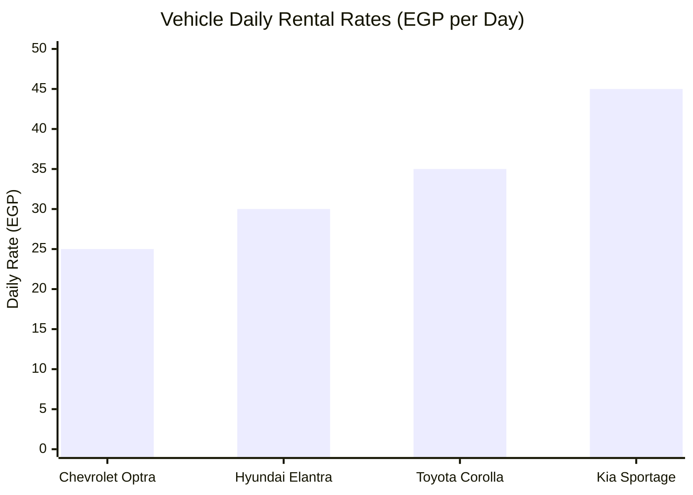
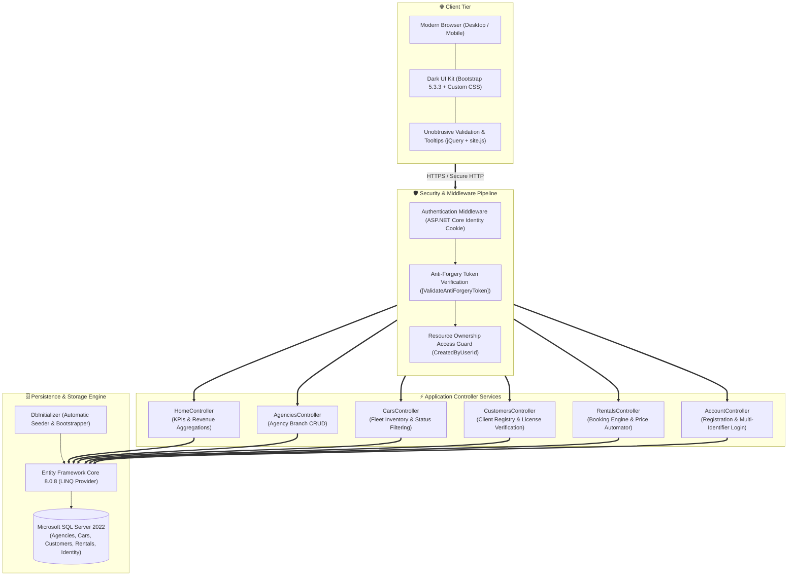
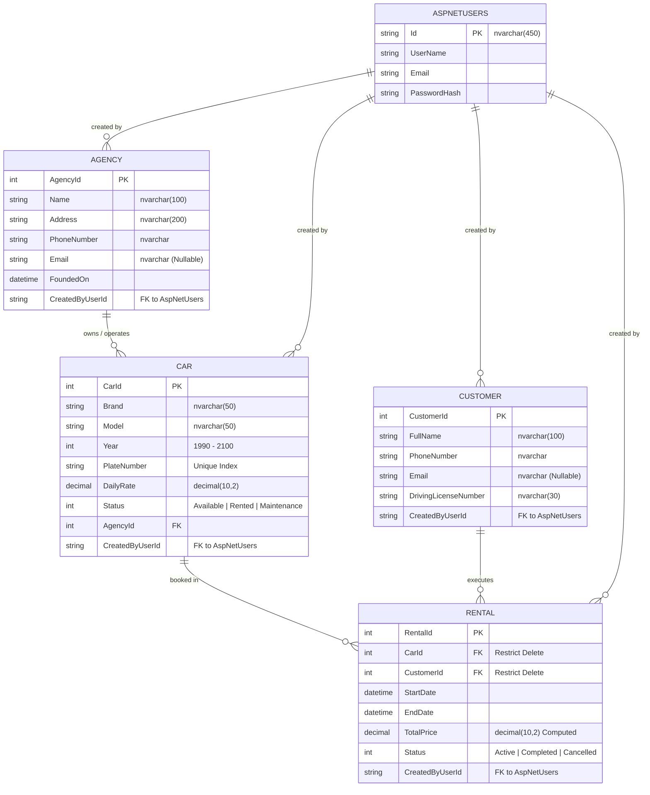
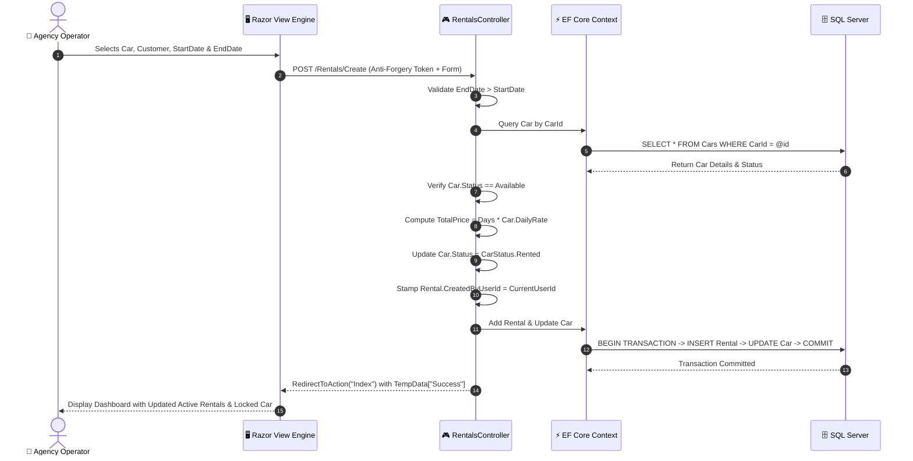

<div align="center">

# 🚘 CarAgencies MVC

### **Modern Cloud-Ready Fleet Telemetry & Multi-Branch Car Rental Platform**

*A production-grade, enterprise-scale management system engineered with ASP.NET Core 8, EF Core, and SQL Server.*

<br/>

[](https://dotnet.microsoft.com/)
[](https://learn.microsoft.com/dotnet/csharp/)
[](https://www.microsoft.com/sql-server)
[](https://www.nuget.org/packages/Microsoft.EntityFrameworkCore)
[](https://www.docker.com/)
[](https://getbootstrap.com/)
[](https://learn.microsoft.com/aspnet/core/security/)
[](LICENSE)

<br/>

```
  ┌────────────────────────────────────────────────────────────────────────────────────────┐
  │  ⚡ Real-Time Fleet Availability  •  💰 Dynamic Auto-Pricing  •  🛡️ Resource Ownership │
  │  🐳 Multi-Stage Docker Cluster   •  📊 Executive Analytics    •  📜 Full Audit Logs    │
  └────────────────────────────────────────────────────────────────────────────────────────┘
```

<br/>

[🌟 Platform Highlights](#-platform-highlights) • [📊 Analytics & Metrics](#-system-telemetry--metrics) • [🏗️ System Architecture](#-system-architecture--blueprints) • [🗄️ Relational Schema](#-relational-database-schema) • [🔄 Workflows](#-transactional-workflows) • [🚀 Quick Start](#-quick-start--deployment)

---

</div>

<br/>

## 🌟 Platform Highlights

<table>
<tr>
<td width="50%" valign="top">

### ⚡ **Operational Engine**
* **Dynamic Fee Calculation:** Contracts automatically compute total lease pricing server-side based on vehicle daily rates and duration:
  $$\text{Total Price} = \max(1, \Delta\text{Days}) \times \text{Daily Rate}$$
* **State-Synchronized Fleet:** Vehicles atomically toggle between `Available`, `Rented`, and `UnderMaintenance` upon checkout and return.
* **Cascading Branch Governance:** Comprehensive agency hierarchy with safe deletion cascades and integrity restrictions.

</td>
<td width="50%" valign="top">

### 🛡️ **Enterprise Security & Architecture**
* **Identity & Ownership Guard:** Custom resource authorization locks edit and delete operations to the exact operator who created the record (`CreatedByUserId`).
* **Anti-Tamper CSRF Guards:** Cryptographic token verification on every mutating HTTP POST request.
* **Concurrency Locking:** Real-time handling of `DbUpdateConcurrencyException` during simultaneous edits.

</td>
</tr>
<tr>
<td width="50%" valign="top">

### 🎨 **Executive UI / UX Design**
* **Custom Dark Theme System:** 788 lines of crafted CSS featuring navy backgrounds (`#0D1117`), electric gradients, card glassmorphism, and responsive stat grids.
* **Instant Filtering & Search:** Multi-parameter search by brand, model, status, license plate, customer name, and contact number.

</td>
<td width="50%" valign="top">

### 🐳 **Cloud-Native Deployment**
* **Multi-Stage Docker Pipeline:** Compiles with SDK 8.0 image and serves through a hardened ASP.NET Core 8 Alpine runtime container.
* **Probed Multi-Service Mesh:** Docker Compose healthcheck integration using `sqlcmd` to ensure SQL Server 2022 availability before web app initialization.

</td>
</tr>
</table>

---

## 📊 System Telemetry & Metrics

### 📈 Core Architecture Benchmarks

| Metric Dimension | Real Value | Architecture Description |
| :--- | :---: | :--- |
| **Target Framework** | `net8.0` | C# 12 running on ASP.NET Core 8 LTS runtime |
| **Controller Actions** | **40 Endpoints** | Distributed across 6 domain controllers |
| **Database Entities** | **11 Tables** | 4 core business domains + 7 ASP.NET Identity tables |
| **Presentation Layer** | **21 Views** | Strongly-typed Razor `.cshtml` views with 6 ViewModels |
| **Custom Styling** | **788 Lines** | High-contrast modern dark design system (`site.css`) |
| **Seed Fleet Assets** | **4 Vehicles** | Across 2 agencies with 300.00 EGP initial transaction volume |
| **Container Footprint** | **2 Services** | Web container (`:8080`) + SQL Server container (`:1433`) |

<br/>

### 📊 Seed Fleet Pricing Distribution & Vehicle Daily Rates



<br/>

### 📊 Initial System Resource Allocation

```
Fleet Availability Ratio:
[██████████████████████████████░░░░░░░░░░] 75% Available (3 Available / 1 Maintenance)

Database Entity Distribution:
├── Business Domain Entities : 36.4% [████████████░░░░░░░░░░░░░░░░░░░░] (4 Tables)
└── Identity Security Tables : 63.6% [█████████████████████░░░░░░░░░░░] (7 Tables)
```

---

## 🏗️ System Architecture & Blueprints

### 1. High-Level System Blueprint



---

### 2. Entity-Relationship Data Model (ERD)



---

### 3. Rental Agreement Sequence & Transaction Flow



---

### 4. Vehicle & Rental Lifecycle State Machine

```mermaid
stateDiagram-v2
    direction LR

    [*] --> Available : Vehicle Enrolled in Agency

    state Available {
        description: Status = CarStatus.Available
        ready: Ready for Customer Booking
    }

    state Rented {
        description: Status = CarStatus.Rented
        locked: Vehicle Locked in Contract
    }

    state UnderMaintenance {
        description: Status = CarStatus.UnderMaintenance
        servicing: Mechanical Check or Repair
    }

    state ActiveRental {
        description: Rental.Status = RentalStatus.Active
    }

    state CompletedRental {
        description: Rental.Status = RentalStatus.Completed
    }

    Available --> Rented : POST /Rentals/Create
    Available --> UnderMaintenance : Operator Updates Car Status
    UnderMaintenance --> Available : Maintenance Finished

    Rented --> ActiveRental : Contract Active
    ActiveRental --> CompletedRental : POST /Rentals/Return/{id}
    CompletedRental --> Available : Vehicle Freed to Inventory
```

---

## 🗄️ Relational Database Schema

The database architecture is designed with **Entity Framework Core 8 Code-First** principles, featuring strict referential integrity rules and audit stamping:

```
CarAgenciesDb
│
├── 📁 1. Fleet & Catalog Domain
│   ├── Agencies                         # Branch network
│   │   ├── AgencyId                     # [PK] Identity
│   │   ├── Name, Address, Phone, Email  # Contact & geolocation details
│   │   ├── FoundedOn                    # Historical operational timestamp
│   │   └── CreatedByUserId              # [Audit] Creator user identifier
│   │
│   └── Cars                             # Fleet inventory
│       ├── CarId                        # [PK] Identity
│       ├── Brand, Model, Year           # Automotive specifications
│       ├── PlateNumber                  # [Unique Index] Official registration tag
│       ├── DailyRate                    # [decimal(10,2)] Base daily rental price
│       ├── Status                       # [Enum] Available (0), Rented (1), UnderMaintenance (2)
│       ├── AgencyId                     # [FK -> Agencies] Cascade Delete on Agency Removal
│       └── CreatedByUserId              # [Audit] Creator user identifier
│
├── 📁 2. Customer & Driver Domain
│   └── Customers                        # Client registry
│       ├── CustomerId                   # [PK] Identity
│       ├── FullName, PhoneNumber, Email # Contact information
│       ├── DrivingLicenseNumber         # Official driver credential
│       └── CreatedByUserId              # [Audit] Creator user identifier
│
├── 📁 3. Transaction & Booking Domain
│   └── Rentals                          # Lease agreements
│       ├── RentalId                     # [PK] Identity
│       ├── CarId                        # [FK -> Cars] Restrict Delete (Historical Protection)
│       ├── CustomerId                   # [FK -> Customers] Restrict Delete (Historical Protection)
│       ├── StartDate, EndDate           # Contract operational timeframe
│       ├── TotalPrice                   # [decimal(10,2)] System-computed monetary total
│       ├── Status                       # [Enum] Active (0), Completed (1), Cancelled (2)
│       └── CreatedByUserId              # [Audit] Creator user identifier
│
└── 📁 4. Identity & Access Domain (ASP.NET Core Identity)
    ├── AspNetUsers                      # Operators, credentials & security stamps
    ├── AspNetRoles                      # Permission definitions
    ├── AspNetUserRoles                  # Operator-to-role associations
    ├── AspNetUserClaims                 # Identity claim tokens
    ├── AspNetRoleClaims                 # Policy claim rules
    ├── AspNetUserLogins                 # External federated logins
    └── AspNetUserTokens                 # Two-Factor and verification security tokens
```

---

## 🛠️ Complete Tech Stack Reference

| Layer | Component | Version | Package / Architecture Role |
| :--- | :--- | :---: | :--- |
| **Runtime & SDK** | [.NET 8.0 SDK](https://dotnet.microsoft.com/) | `8.0.8` | Modern C# 12 JIT runtime with native AOT and cross-platform capabilities |
| **Web Framework** | [ASP.NET Core MVC](https://dotnet.microsoft.com/apps/aspnet/mvc) | `8.0.8` | High-throughput server-rendered Controller-Action architecture |
| **Authentication** | [ASP.NET Core Identity EF](https://www.nuget.org/packages/Microsoft.AspNetCore.Identity.EntityFrameworkCore) | `8.0.8` | User management, secure password hashing, and cookie session token lifecycle |
| **Data Access** | [EF Core SQL Server](https://www.nuget.org/packages/Microsoft.EntityFrameworkCore.SqlServer) | `8.0.8` | Object-Relational Mapping (ORM) executing optimized parameterized SQL queries |
| **Migration Tools** | [EF Core Tools & Design](https://www.nuget.org/packages/Microsoft.EntityFrameworkCore.Design) | `8.0.8` | Code-First database schema scaffolding, snapshotting, and synchronization |
| **Database** | [Microsoft SQL Server](https://www.microsoft.com/sql-server) | `2022-latest` | Enterprise relational database management engine with transactional ACID integrity |
| **CSS System** | [Bootstrap 5](https://getbootstrap.com/) | `5.3.3` | Grid system, form validation visuals, flexbox layouts, and modal dialogues |
| **Iconography** | [Bootstrap Icons](https://icons.getbootstrap.com/) | `1.11.3` | High-fidelity vector iconography across menus, buttons, and badges |
| **Client Scripting** | [jQuery & Unobtrusive](https://jqueryvalidation.org/) | `3.7.1` / `4.0.0` | Client-side validation triggers prior to server transmission |
| **Containerization** | [Docker](https://www.docker.com/) | Multi-Stage | Hardened container packaging with separate compilation and runtime stages |
| **Orchestration** | [Docker Compose](https://docs.docker.com/compose/) | Compose v2 | Automated multi-container networking with active database health probing |

---

## 🌐 API Surface & Controller Route Catalog

The platform exposes **40 action routes** through ASP.NET Core Endpoint Routing:

### 1. Authentication & Security Routes (`/Account`)
```http
GET  /Account/Register          -> Render operator registration portal
POST /Account/Register          -> Validate form, register Identity user & sign in
GET  /Account/Login             -> Render operator login form (supports email or username)
POST /Account/Login             -> Verify credentials & set persistent auth cookie
POST /Account/Logout            -> Invalidate session & terminate cookie
```

### 2. Operational Analytics Routes (`/Home`)
```http
GET  /                          -> Redirect / load Executive Dashboard
GET  /Home/Index                -> Aggregate total agencies, cars, revenue & recent contracts
GET  /Home/Error                -> Diagnostics and error presentation view
```

### 3. Agency Branch Management Routes (`/Agencies`)
```http
GET  /Agencies                  -> List all agencies with optional name query (?searchString=)
GET  /Agencies/Details/{id}     -> Display branch overview, car statistics & assigned fleet
GET  /Agencies/Create           -> Render branch creation form
POST /Agencies/Create           -> Validate and store new agency with creator ownership
GET  /Agencies/Edit/{id}        -> Render edit view (Owner-restricted)
POST /Agencies/Edit/{id}        -> Update agency branch details (Owner-restricted)
GET  /Agencies/Delete/{id}      -> Render delete confirmation dialogue (Owner-restricted)
POST /Agencies/Delete/{id}      -> Remove agency & cascade-delete assigned cars (Owner-restricted)
```

### 4. Fleet Inventory & Tracking Routes (`/Cars`)
```http
GET  /Cars                      -> List fleet with dual filtering (?agencyId=&status=)
GET  /Cars/Details/{id}         -> View vehicle technical specs & complete rental history
GET  /Cars/Create               -> Render vehicle registration form with agency select list
POST /Cars/Create               -> Register new car into agency inventory
GET  /Cars/Edit/{id}            -> Render vehicle edit form (Owner-restricted)
POST /Cars/Edit/{id}            -> Update vehicle specifications (Owner-restricted)
GET  /Cars/Delete/{id}          -> Render vehicle deletion confirmation (Owner-restricted)
POST /Cars/Delete/{id}          -> Remove car (Restricted if historical rentals exist)
```

### 5. Client Registry Routes (`/Customers`)
```http
GET  /Customers                 -> List clients with name/phone search (?searchString=)
GET  /Customers/Details/{id}    -> View client profile and historical booking contracts
GET  /Customers/Create          -> Render driver registration form
POST /Customers/Create          -> Register client with driving license number
GET  /Customers/Edit/{id}       -> Render client edit form (Owner-restricted)
POST /Customers/Edit/{id}       -> Update client contact information (Owner-restricted)
GET  /Customers/Delete/{id}     -> Render deletion confirmation (Owner-restricted)
POST /Customers/Delete/{id}     -> Remove client (Restricted if historical rentals exist)
```

### 6. Rental Booking & Contract Lifecycle Routes (`/Rentals`)
```http
GET  /Rentals                   -> List contracts with status filter (?status=)
GET  /Rentals/Details/{id}      -> 3-column detailed overview (Car, Client, Contract)
GET  /Rentals/Create            -> Render booking form with available vehicles & client list
POST /Rentals/Create            -> Calculate price, lock car as Rented, create active contract
GET  /Rentals/Edit/{id}         -> Render contract edit view (Owner-restricted)
POST /Rentals/Edit/{id}         -> Update contract terms (Owner-restricted)
GET  /Rentals/Delete/{id}       -> Render deletion confirmation (Owner-restricted)
POST /Rentals/Delete/{id}       -> Remove contract (Owner-restricted)
POST /Rentals/Return/{id}       -> Complete contract, mark Completed, free car to Available
```

---

## 📂 Repository Directory Tree

```
CarAgenciesMVC/
├── 📁 Controllers/                     # Application HTTP Request Handlers
│   ├── AccountController.cs            # Identity session management & credentials
│   ├── AgenciesController.cs           # Agency branch management & ownership guards
│   ├── CarsController.cs               # Fleet inventory, status tracking & filtering
│   ├── CustomersController.cs          # Client registry & driver license records
│   ├── HomeController.cs               # Executive KPI dashboard & revenue metrics
│   └── RentalsController.cs            # Rental lifecycle, pricing & return triggers
│
├── 📁 Data/                            # Persistence Infrastructure
│   ├── ApplicationDbContext.cs         # EF Core DbContext with fluent relationship rules
│   └── DbInitializer.cs                # Database bootstrapper with pre-seeded dataset
│
├── 📁 Migrations/                      # Schema Versioning & Evolution
│   └── ApplicationDbContextModelSnapshot.cs # Complete schema snapshot of all 11 tables
│
├── 📁 Models/                          # Domain Business Entities
│   ├── Agency.cs                       # Branch representation with contact metadata
│   ├── Car.cs                          # Vehicle specifications, daily rate & status
│   ├── Customer.cs                     # Client profile with driver license number
│   ├── Rental.cs                       # Binding contract between Car and Customer
│   └── 📁 Enums/                       # Domain Enumerations
│       ├── CarStatus.cs                # Available (0), Rented (1), UnderMaintenance (2)
│       └── RentalStatus.cs             # Active (0), Completed (1), Cancelled (2)
│
├── 📁 ViewModels/                      # Presentation Data Transfer Objects (DTOs)
│   ├── AgencyDetailsViewModel.cs       # Branch stats & fleet count breakdowns
│   ├── CarFormViewModel.cs             # Vehicle form wrapper with dynamic dropdowns
│   ├── DashboardViewModel.cs           # Executive dashboard metrics & recent rentals
│   ├── LoginViewModel.cs               # Authentication form with remember-me token
│   ├── RegisterViewModel.cs            # Account registration with password policies
│   └── RentalFormViewModel.cs          # Contract creation form with active inventory
│
├── 📁 Views/                           # Razor Presentation Templates (.cshtml)
│   ├── 📁 Account/                     # Register.cshtml, Login.cshtml
│   ├── 📁 Agencies/                    # Index, Details, Create, Edit, Delete
│   ├── 📁 Cars/                        # Index, Details, Create, Edit, Delete
│   ├── 📁 Customers/                   # Index, Details, Create, Edit, Delete
│   ├── 📁 Home/                        # Index.cshtml (Dashboard), Error.cshtml
│   ├── 📁 Rentals/                     # Index, Details, Create, Edit, Delete
│   ├── 📁 Shared/                      # _Layout.cshtml, _ValidationScriptsPartial.cshtml
│   ├── _ViewImports.cshtml             # Global tag helpers and namespace bindings
│   └── _ViewStart.cshtml               # Shared layout master binding
│
├── 📁 wwwroot/                         # Public Static Assets
│   ├── 📁 css/site.css                 # 788-line custom Dark Theme UI Kit
│   └── 📁 js/site.js                   # Bootstrap tooltips & deletion confirmations
│
├── .dockerignore                       # Container build exclusion definitions
├── appsettings.json                    # Connection strings, logging & hosting configs
├── CarAgenciesMVC.csproj               # .NET 8 Project file with NuGet package dependencies
├── docker-compose.yml                  # Two-service mesh configuration (Web + MSSQL 2022)
├── Dockerfile                          # Multi-stage compilation & runtime definition
└── Program.cs                          # Dependency injection, middleware & bootloader
```

---

## 🚀 Quick Start & Deployment

### Option 1: Native Local Development (.NET CLI)

1. **Clone the Repository:**
   ```bash
   git clone https://github.com/[YOUR-USERNAME]/CarAgenciesMVC.git
   cd CarAgenciesMVC
   ```

2. **Configure Database Connection (`appsettings.json`):**
   ```json
   {
     "ConnectionStrings": {
       "DefaultConnection": "Server=(localdb)\\mssqllocaldb;Database=CarAgenciesDb;Trusted_Connection=True;MultipleActiveResultSets=true"
     }
   }
   ```

3. **Restore & Compile:**
   ```bash
   dotnet restore
   dotnet build
   ```

4. **Launch Application:**
   ```bash
   dotnet run
   ```
   *The database schema and initial test records will be automatically created on startup via `DbInitializer.Initialize()`.*

5. **Open Browser:**
   - HTTPS: `https://localhost:5001`
   - HTTP: `http://localhost:5000`

---

### Option 2: Production Container Mesh (Docker Compose)

Launch the entire stack with zero external dependencies:

1. **Start Services in Background:**
   ```bash
   docker compose up -d --build
   ```

2. **Check Container Health:**
   ```bash
   docker compose ps
   ```
   *The web application will automatically delay initialization until SQL Server 2022 passes its internal healthcheck.*

3. **Stream Service Logs:**
   ```bash
   docker compose logs -f webapp
   ```

4. **Access the Portal:**
   - **Web Application:** `http://localhost:8080`
   - **SQL Server Database:** `localhost:1433` (`CarAgenciesDb` | User: `sa` | Password: `CarAgencies@123`)

5. **Stop Stack:**
   ```bash
   docker compose down
   ```
   *(To wipe persistent database volumes, append `-v`: `docker compose down -v`)*

---

## 👥 Authors & Acknowledgements

Developed as the **Graduation Capstone Project for the Information Technology Institute (ITI) C# Track**:

- **Mohamed Abdelaty Mohamed Elshaboury** (ID: 75)
- **Reem Ahmed Amin Hashish** (ID: 74)

---

## 📄 License

This project is licensed under the **MIT License**. See the [LICENSE](LICENSE) file for details.
# Car-Agencies-Rental

